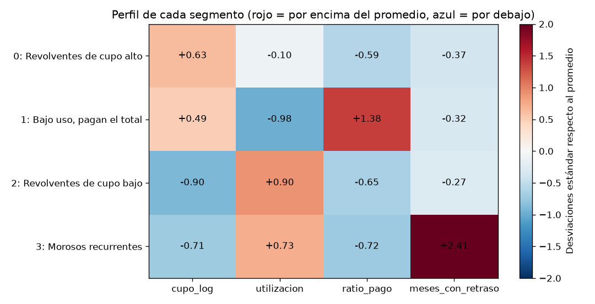
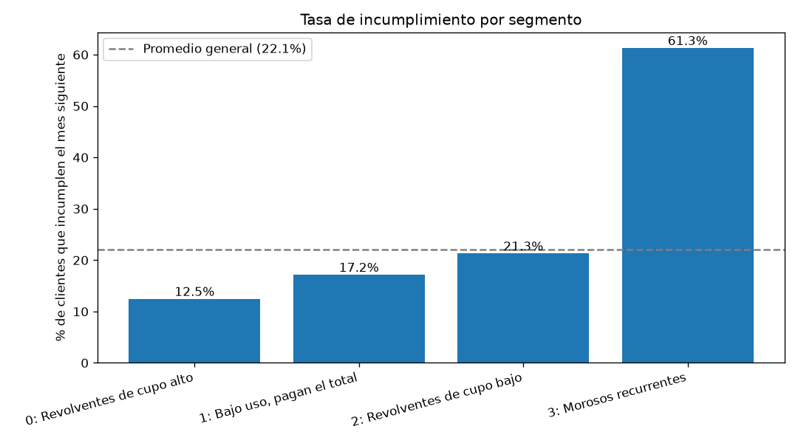
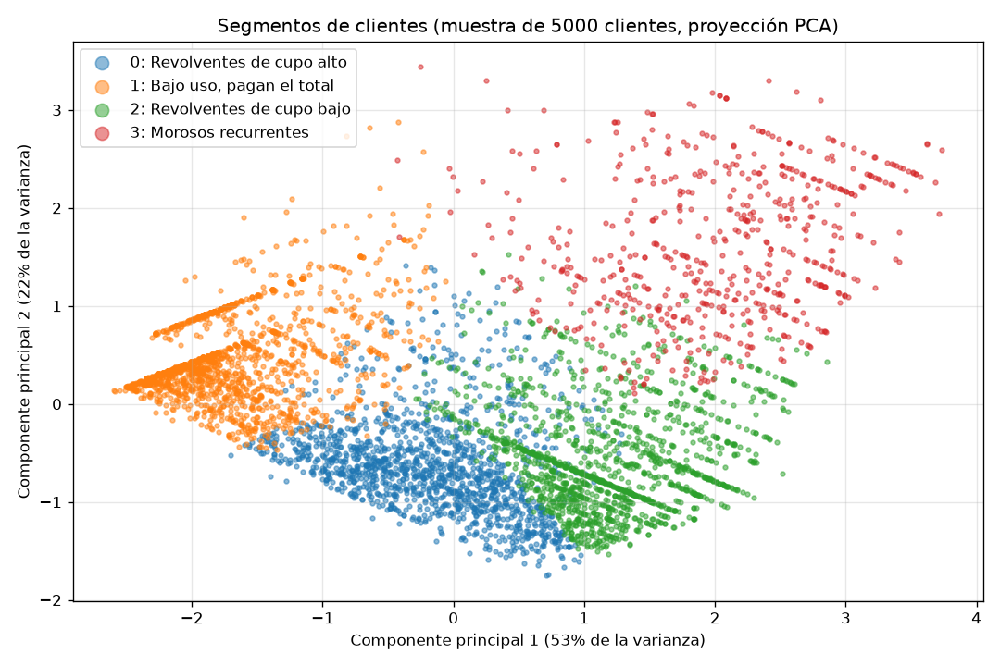

# Documento de hallazgos: segmentación de clientes de tarjeta de crédito

## La pregunta

**¿Qué perfiles de clientes existen según su comportamiento de uso y pago de la tarjeta,
para que el área de riesgo crediticio defina políticas diferenciadas por segmento?**

Hoy los 30.000 clientes se gestionan con las mismas reglas. Este análisis busca grupos
de clientes que se comportan de forma parecida, para aplicar a cada grupo la política
que le corresponde.

## La respuesta: cuatro perfiles de clientes

El análisis identificó **cuatro segmentos** a partir de cuatro comportamientos:
el tamaño del cupo, cuánto lo usan, qué parte de lo facturado pagan y en cuántos meses
se atrasaron.

*Cómo leer la gráfica: rojo = por encima del promedio de clientes; azul = por debajo.*

| Segmento | % de clientes | Cupo promedio | Uso del cupo | Pagan de lo facturado | Incumplen el mes siguiente |
|---|---|---|---|---|---|
| **Revolventes de cupo alto** | 28,8% | 238.000 NT$ | 34% | 12% | **12,5%** |
| **Bajo uso, pagan el total** | 31,5% | 226.000 NT$ | 4% | 87% | **17,2%** |
| **Revolventes de cupo bajo** | 28,0% | 62.000 NT$ | 68% | 10% | **21,3%** |
| **Morosos recurrentes** | 11,7% | 86.000 NT$ | 62% | 7% | **61,3%** |

### ¿Estos segmentos sirven para medir el riesgo?

Sí. El modelo **no conoció** qué clientes incumplieron: formó los grupos solo con
su comportamiento. Aun así, los segmentos tienen niveles de riesgo muy distintos.

El segmento de mayor riesgo incumple **casi 5 veces más** que el de menor riesgo
(61,3% frente a 12,5%; el promedio general es 22,1%).

## Hallazgos principales

**1. Un grupo pequeño concentra gran parte del problema.** Los *Morosos recurrentes*
son solo el 12% de los clientes, pero concentran **≈32%** de todos los incumplimientos.
Se atrasaron en promedio en 4,6 de los últimos 6 meses.

**2. El cupo bajo casi agotado es una señal de alerta temprana.** Los *Revolventes de
cupo bajo* todavía no tienen retrasos frecuentes (0,4 meses en promedio), pero usan el
68% de su cupo, pagan apenas el 10% y su incumplimiento (21,3%) ya casi duplica el de
los revolventes de cupo alto. Son el grupo con más probabilidad de convertirse en
morosos.

**3. Usar la tarjeta y pagar el mínimo no es, por sí solo, riesgoso.** Los *Revolventes
de cupo alto* pagan poco de lo facturado (12%), pero son el segmento con **menor**
incumplimiento (12,5%). Para el banco son clientes rentables (generan intereses) y
seguros.

**4. Pagar el total no garantiza bajo riesgo.** Sorprendentemente, el segmento
*Bajo uso, pagan el total* incumple más (17,2%) que los revolventes de cupo alto.
Una posible explicación es que incluye clientes inactivos cuya situación financiera
el banco no puede observar porque casi no usan la tarjeta. **Es una hipótesis**: el
modelo no la demuestra y conviene revisarla.

**5. La edad no distingue a los segmentos.** Todos promedian unos 35 años. Lo que separa
a los clientes es **cómo usan y pagan** la tarjeta, no su perfil demográfico.

## Recomendaciones

| Segmento | Acción recomendada | Por qué |
|---|---|---|
| **Morosos recurrentes** | Priorizar la gestión de cobranza; congelar aumentos de cupo; ofrecer acuerdos de pago | Concentran la mayor parte de las pérdidas con solo el 12% de los clientes |
| **Revolventes de cupo bajo** | Activar **alertas preventivas** cuando el uso supere un umbral; no aumentar el cupo; ofrecer asesoría financiera | Es el grupo con mayor riesgo de pasar a moroso: actuar antes del retraso es más barato que cobrar después |
| **Revolventes de cupo alto** | Programas de **fidelización** y venta de otros productos; evaluar aumentos de cupo | Bajo riesgo y alta rentabilidad |
| **Bajo uso, pagan el total** | Revisar si hay clientes **inactivos**; campañas de activación de uso con monitoreo | Su riesgo es mayor de lo esperado; conviene entender el motivo antes de incentivar el consumo |

## ¿Qué tan confiables son estos resultados?

- **Los segmentos separan bien el riesgo**, aunque el modelo nunca vio esa
  información. Es la principal evidencia de que son útiles.
- **Los límites entre segmentos no son nítidos.** La métrica de separación (silueta = 0,37)
  indica una estructura razonable con algo de superposición: el comportamiento de pago
  es gradual y muchos clientes están "entre" dos segmentos.

  

- **Los segmentos describen, no explican causas.** Indican qué clientes se parecen,
  no *por qué* se comportan así.

## Limitaciones

- **Datos antiguos y de otro país:** Taiwán, abril-septiembre de 2005. Antes de aplicar
  las políticas, conviene repetir el análisis con datos actuales del banco.
- **Ventana corta:** el incumplimiento se mide solo en el mes siguiente.
- **Aproximación en el pago:** la proporción pagada se calcula con totales de 6 meses,
  porque los pagos de un mes corresponden a la factura del mes anterior.
- **Variables ausentes:** no hay información de ingresos ni de otras deudas, que
  mejorarían la segmentación.
- **Se excluyó el sexo** de los clientes por razones éticas.