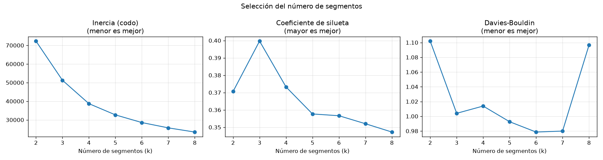

# EA3 – Segmentación de clientes de tarjeta de crédito con K-means

Proyecto de Machine Learning no supervisado que identifica perfiles de clientes según
su comportamiento de uso y pago, para apoyar políticas de riesgo diferenciadas.
El flujo completo se ejecuta automáticamente con GitHub Actions.

📄 **Documento de hallazgos (respuesta a la pregunta de negocio): [HALLAZGOS.md](HALLAZGOS.md)**

## Integrantes

- Duvan Quintero Guerra (trabajo individual)

## Pregunta de negocio

> ¿Qué perfiles de clientes existen según su comportamiento de uso y pago de la tarjeta,
> para que el **área de riesgo crediticio** defina **políticas diferenciadas por segmento**?

- **Quién la necesita:** el área de riesgo crediticio y de producto de tarjetas.
- **Qué decisión apoya:** qué política aplicar a cada segmento (fidelización, activación,
  alertas preventivas o cobranza), en lugar de tratar igual a todos los clientes.

## Dataset

| | |
|---|---|
| **Identificador** | `scikit-learn/credit-card-clients` |
| **Enlace** | https://huggingface.co/datasets/scikit-learn/credit-card-clients |
| **Split** | `train` (archivo `UCI_Credit_Card.csv`) |
| **Tamaño** | 30.000 clientes × 25 columnas |
| **Contenido** | Clientes de tarjetas de crédito en Taiwán, abril-septiembre de 2005 |

**Columnas relevantes:** `LIMIT_BAL` (cupo), `BILL_AMT1`…`6` (facturas),
`PAY_AMT1`…`6` (pagos), `PAY_0`…`PAY_6` (meses de retraso) y
`default.payment.next.month` (incumplimiento, usado solo para validar).

**¿Por qué este dataset responde la pregunta?** Contiene seis meses de historial real
de cupo, consumo, pagos y retrasos de cada cliente: exactamente el comportamiento que
define los perfiles. Además incluye el incumplimiento posterior, que permite comprobar
si los segmentos encontrados tienen niveles de riesgo distintos.

*Nota: este dataset se utilizó también en la EA2 del mismo autor, con un enfoque distinto
(regresión y clasificación supervisadas).*

## Tipo de aprendizaje y modelo

**No supervisado**, porque no existe una etiqueta de "tipo de cliente": los perfiles
hay que **descubrirlos** en los datos, no predecirlos.

**Algoritmo: K-means.** Es adecuado porque todas las variables son numéricas, el
volumen (≈30.000 clientes) es manejable, y cada segmento queda representado por un
"cliente promedio" (centroide) fácil de describir al negocio.

### Cómo funciona K-means, paso a paso

1. **Se elige el número de grupos (k).** En este proyecto, k = 4 (ver selección abajo).
2. **Se ubican k centroides iniciales.** Con `k-means++`, el primero se elige al azar
   y los siguientes, preferentemente lejos de los ya elegidos.
3. **Asignación:** cada cliente se asigna al centroide más cercano (distancia euclidiana).
4. **Actualización:** cada centroide se mueve al promedio de los clientes que tiene asignados.
5. **Se repiten los pasos 3 y 4** hasta que los centroides prácticamente dejan de moverse
   (aquí convergió en 15 iteraciones).
6. Como el resultado depende del inicio, **todo el proceso se repite 10 veces** (`n_init`)
   y se conserva la ejecución con menor inercia.

### Parámetros

| Parámetro | Valor | Significado |
|---|---|---|
| `n_clusters` | 4 | Número de segmentos (elegido con evidencia) |
| `init` | `k-means++` (por defecto) | Inicialización con centroides alejados entre sí |
| `n_init` | 10 | Repeticiones con distintos inicios |
| `max_iter` | 300 (por defecto) | Máximo de iteraciones por repetición |
| `tol` | 0,0001 (por defecto) | Umbral de movimiento para considerar convergencia |
| `random_state` | 42 | Reproducibilidad |

### Ventajas y limitaciones

| Ventajas | Limitaciones |
|---|---|
| Simple, rápido y escalable a muchos clientes | Hay que fijar k de antemano |
| Los centroides son fáciles de interpretar | Asume grupos "redondos" y de tamaño similar |
| Resultado reproducible con semilla fija | Sensible a la escala de las variables y a valores extremos (por eso se escala y se recorta) |
| | Siempre asigna cada cliente a un grupo, aunque esté entre dos |

## Preprocesamiento

| Operación | Problema que resuelve |
|---|---|
| Eliminar `ID` y 35 duplicados (detectados sin `ID`) | Filas repetidas sesgan los centroides |
| Eliminar `SEX` | Consideración ética: no discriminación |
| Agrupar códigos no documentados de `EDUCATION` y `MARRIAGE` | Valores sin significado en la documentación |
| Crear 4 variables de comportamiento: `cupo_log`, `utilizacion`, `ratio_pago`, `meses_con_retraso` | Las 18 columnas mensuales están muy correlacionadas y pesarían de más en las distancias |
| Logaritmo del cupo | Fuerte sesgo (asimetría 0,99 → −0,51) |
| Recortar `utilizacion` en el percentil 99 | Valores extremos (hasta 5,36) arrastrarían los centroides |
| Excluir `retraso_maximo` del clustering | Correlación 0,82 con `meses_con_retraso`: el retraso pesaría el doble |
| `StandardScaler` | K-means usa distancias: sin escalar, el cupo (desviación ≈130.000) dominaría a las proporciones (desviación < 1) |

**Sin división train/test:** al ser no supervisado, no hay predicciones que evaluar con
datos no vistos; las métricas miden la calidad interna de los grupos.

## Selección del número de segmentos



| Criterio | Resultado |
|---|---|
| Método del codo | Quiebre en k = 4: desde ahí, la mejora por segmento adicional cae a la mitad |
| Silueta | Máximo en k = 3 (0,400); k = 4 obtiene 0,373 |
| Davies-Bouldin | Prácticamente igual entre k = 3 y k = 7 (0,98–1,01) |
| **Validación externa** | Con k = 3, dos segmentos muy distintos tienen el mismo riesgo (16,7% y 16,1%). Con k = 4 el riesgo se separa en cuatro niveles (12,5% → 61,3%) |

**Decisión: k = 4.** Combina el codo, una silueta aceptable y, sobre todo, mayor utilidad
para el negocio.

## Estructura del proyecto

```
├── .github/workflows/pipeline.yml   # GitHub Actions
├── src/
│   ├── data_loader.py               # Carga desde Hugging Face → DataFrame
│   ├── preprocessing.py             # Limpieza, variables de comportamiento, escalado
│   ├── clustering_model.py          # Selección de k, K-means, perfil y nombres de segmentos
│   ├── visualization.py             # Gráficas
│   └── report.py                    # Resumen .txt
├── main.py                          # Orquesta el flujo completo
├── outputs/                         # Resumen .txt y gráficas generadas
├── HALLAZGOS.md                     # Documento de hallazgos
└── requirements.txt
```

## Cómo ejecutar

```bash
python -m venv .venv
.venv\Scripts\activate        # Windows (Linux/macOS: source .venv/bin/activate)
pip install -r requirements.txt
python main.py
```

Los resultados se generan en `outputs/`. Cada `push` a `main` ejecuta el mismo flujo en
GitHub Actions y publica el resumen y las gráficas como artefacto `resultados-segmentacion`.

## Evidencias

| Evidencia | Ubicación |
|---|---|
| Carga y estructura del DataFrame | Log de Actions, paso "Ejecutar flujo completo" |
| Preprocesamiento antes/después | Log de Actions y sección 3 de `outputs/resumen_ejecucion.txt` |
| Selección de k | `outputs/seleccion_k.png` y sección 5 del resumen |
| Métricas del modelo | Sección 6 del resumen |
| Perfil de segmentos y validación | Sección 7 del resumen y gráficas en `outputs/` |
| Hallazgos y recomendaciones | [HALLAZGOS.md](HALLAZGOS.md) |
| Ejecución exitosa | https://github.com/duvandeguerra/ea3-segmentacion-clientes-credito/actions/runs/42544214109 |